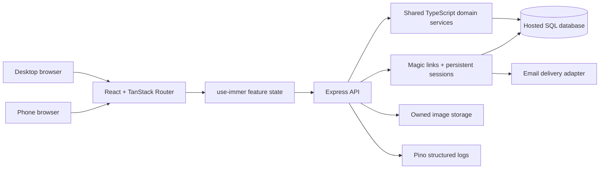

# Vutadex web application plan

Status: proposed implementation plan, October 30, 2026.
Repository: `chrisbirster/vutadex`.

## Goal and stack

Build a responsive Vutadex web application for desktop and phone browsers in this repository. Users sign in through an emailed magic link and use the same saved collection and study progress on every device.

User-selected stack:

- React and TypeScript for the web UI.
- TanStack Router for typed routes, route loading, navigation, and authenticated layouts.
- `use-immer` / `useImmerReducer` for immutable UI and editing state, using feature-scoped React contexts when state must be shared.
- ExpressJS and TypeScript for the HTTP server and API.
- Pino, with request logging and redaction, for structured application logs.
- The four supplied Vutadex illustrations as the visual direction for Home, Study, Add Cards, and Stats.

Supporting defaults proposed for the first milestone:

- Vite for frontend development/builds; npm workspaces and one committed lockfile.
- Keep the currently supported Node release until a compatibility check justifies changing it. Pin compatible stable dependency versions when scaffolding.
- Hosted Turso/libSQL as the initial persistent SQL database, with local SQLite development and isolated test databases. This continues the existing hosted data direction; M0 must validate the Node driver, transaction semantics, session storage, migrations, and deployment constraints before committing to it.
- Express serves `/api/v1` and the built SPA from the same app origin. Vite proxies API requests in development.
- Reuse the existing SES-backed email delivery capability through a server-side adapter; use a local mail inbox/test adapter during development. Verify the current service and domain configuration in M2.
- Durable database-backed browser sessions. No dependency on one server process's memory.
- Object storage for user-uploaded images; database records store ownership, metadata, checksums, and storage keys.
- Ordinary fetch requests plus router loaders and feature stores initially. TanStack Query, Redux, and Zustand are not required for this design.

These supporting defaults are implementation decisions to validate, not additional user requirements or commitments to purchase services.

## Architecture and boundaries



### Repository organization

Target structure, reached incrementally rather than by moving everything at once:

```text
apps/
  web/                 React, TanStack Router, use-immer, styles and UI assets
  server/              Express, authentication, API routes, Pino, email adapter
  cli/                 Existing vdex command interface, when relocation is safe
packages/
  domain/              Pure scheduler, note validation and generation, study rules
  contracts/           Runtime request/response schemas and TypeScript API types
  storage/             Migrations, owned repositories, transactions, change feed
  test-support/        Fixtures, clock/email adapters, test accounts and databases
docs/
  web-app-plan.md
  architecture/
  design/
```

Preserve the current CLI and uncommitted work before restructuring. Existing CLI entry points can stay at the root until the workspace migration is tested. Separate web/server development commands from the existing CLI commands; do not silently redefine the existing start behavior during initial scaffolding.

Reuse the tested TypeScript scheduler, note generation, and study policies from this repo through explicit shared interfaces. Selectively reuse compatible React UI ideas and assets from `chrisbirster/flashcards`; adapt React Router navigation to TanStack Router and its state to use-immer. Reimplement the backend in Express as requested. Do not bring the competing Go/Solid runtime into the new application.

### State ownership

| State | Owner and persistence |
|---|---|
| Decks, notes, generated cards, media, reviews and schedules | Server database, scoped to the authenticated account |
| Active study queue, retry deadlines, shuffle order, undo history | Server database, versioned and resumable on another device |
| Email identity, sessions and preferences | Server database; each browser has its own session |
| Editor draft before save | use-immer locally; debounced account-scoped server draft save when authenticated |
| Dialogs, revealed answer, pending inputs and validation messages | use-immer UI state; reveal state may reset on another device without changing progress |
| Navigation, filters and shareable search state | TanStack Router routes and validated search parameters |
| Loaded server records | Feature-scoped use-immer store, indexed by ID and server revision; refresh from the API |

Immer provides immutable updates inside a browser. It does not synchronize devices or provide database transactions. Cross-device consistency comes from server persistence, revision checks, and refresh/change notifications. There is one account source of truth, not a separate authoritative collection in each browser's localStorage.

Draft and user-data stores must be cleared or re-scoped when the active user changes. Abort obsolete requests and reject older responses so an earlier request cannot overwrite newer state or another account's data.

## Authentication and cross-device behavior

### Proposed sign-in flow

1. The user enters their email on `/login`.
2. `POST /api/v1/auth/magic-links` creates a short-lived sign-in challenge and sends a link. The response is generic regardless of whether the account already exists.
3. The email opens a confirmation page. A read-only GET must not consume the link; this prevents common email preview/scanner visits from signing in or invalidating it.
4. The user confirms sign-in. `POST /api/v1/auth/magic-links/consume` atomically consumes the one-time token, resolves the verified email to one user, and creates a new persistent browser session.
5. Express sets an opaque, `HttpOnly`, `Secure`, `SameSite=Lax` cookie and returns account/session metadata. Use a host-only cookie, such as `__Host-vutadex_session`, with `Path=/` and no `Domain` attribute in production.
6. TanStack Router loads `GET /api/v1/session`, initializes the account-scoped feature stores, and navigates to the permitted return route.
7. The user can repeat this process on another browser using the same email. That creates another session for the same account, accessing the same server-stored collection and study progress.

Proposed policy: magic links expire after 15 minutes and are single-use; sessions have a 30-day inactivity timeout and 90-day absolute lifetime, with server-enforced revocation. Validate those defaults in M0/M2 and make the policy explicit in the product.

Opening an email link on a phone signs in the phone browser. It does not silently sign in an unrelated desktop browser. Desktop and phone each establish their own session; the account and data are shared, not the cookie.

### Required authentication tasks

- Cryptographically random tokens; store token hashes, not redeemable plaintext tokens.
- Atomic redemption and expiry/replay checks, including simultaneous redemption attempts.
- Put the token in a URL fragment or an equivalent flow that avoids routine access-log capture; exchange it in a POST body, remove it from browser history, and avoid third-party assets on the callback page.
- Confirmation UI, permitted return-path validation, login-CSRF handling, and safe expired/used-link recovery.
- Rate limits and resend cooldowns by email and network source; distributed enforcement where needed.
- An explicit email canonicalization policy. Do not rewrite provider-specific dots or plus addresses into a different identity.
- Persistent session lookup, renewal, expiry, rotation after login, logout, per-device revocation, and sign out all devices.
- Origin/CSRF protection for authenticated mutations. UI route guards complement server authorization; they never replace it.
- All note, card, deck, media, draft, review, session, and export reads/writes scoped to the authenticated account.
- Pino must omit/redact cookies, authorization headers, magic-link tokens, callback URLs, email provider credentials, and request bodies containing private study content. Redacting headers alone is insufficient if tokens appear inside logged URLs.
- No email-change or account-merging workflow in the initial release unless separately specified; those require additional identity verification rules.

## Visual direction and routes

The references define a warm, illustrated product: cream surfaces, mint/teal navigation and actions, pale blue/yellow/coral panels, dark navy typography, rounded cards, and recurring tabby-cat artwork. Use the cat art to support the experience while keeping questions, answers, buttons, labels, and charts as actual accessible UI.

| Reference | Intended screen |
|---|---|
| `ChatGPT Image Oct 30, 2026, 09_23_07 PM-1.png` | Home overview, deck grid/list, study/create/import actions, activity |
| `ChatGPT Image Oct 30, 2026, 09_23_08 PM-2.png` | Study card, reveal, four ratings, interval previews, session progress |
| `ChatGPT Image Oct 30, 2026, 09_23_08 PM-3.png` | Deck-aware card/note creation, type selection, content fields, live preview |
| `ChatGPT Image Oct 30, 2026, 09_23_09 PM-4.png` | Statistics, review activity, retention, due forecast, per-deck performance |

Original reference images are in the user's Downloads folder and attached to this planning conversation. M3 should place approved reference/production assets in the repository with clear naming and provenance.

Proposed routes:

```text
/login
/auth/verify
/                              Home
/decks                         Deck browser
/decks/$deckId                 Deck contents and actions
/decks/new                     Create deck
/cards/new?deckId=...           Add Cards entry point, creates logical notes
/notes/$noteId/edit             Edit source note and preview generated cards
/study                         Select deck and study options
/study/$sessionId              Resume durable study session
/stats                         Global and filtered statistics
/settings                      Profile, timezone, study preferences
/settings/sessions             Device sessions and revocation
```

Use “Add Cards” as the obvious navigation label while explaining that a note can generate multiple cards. Reverse, cloze, and other generated cards stay attached to their source note; editing the note updates them safely.

Desktop: persistent sidebar and central content, with context panels where useful. Phone: compact navigation and a single main column; stack/collapse preview and secondary panels, keep primary actions reachable, and remove decorative artwork when it crowds content. Support keyboard-only use, reduced motion, readable body typography, and sufficient contrast. The screenshots are design references, not a requirement to flatten the interface into an image or display invented metrics.

## Milestone summary

| Milestone | Outcome | Depends on |
|---|---|---|
| M0 | Repository, data, and shared-domain decisions recorded | — |
| M1 | React/Router/Immer and Express/Pino foundations running | M0 |
| M2 | Magic-link accounts, durable sessions, owned persistence | M1 |
| M3 | Responsive illustrated design system and application shell | M1; M2 for real account states |
| M4 | Deck, note/card, media, import/export workflows | M2, M3 |
| M5 | Authoritative FSRS study sessions, retries and undo | M2, M4 |
| M6 | Consistent phone/desktop data, drafts and session handoff | M4, M5 |
| M7 | Home, statistics and settings backed by real data | M3–M6 |
| M8 | Validated migration/import path for existing users and data | M2, M4–M6 |
| M9 | End-to-end, accessibility, failure and performance release gates | M4–M8 |
| M10 | Staging, operational readiness and production release | M9 |

The first useful vertical slice is M1 + M2 + a minimal M3/M4: sign in, create a deck and note, and see it on another device. M5 adds the complete learning loop. M6 is required before claiming dependable cross-device study continuity.

## M0 — Preserve the existing work and settle boundaries

- [ ] **M0.1** Inventory the current CLI changes, capture a recoverable snapshot, and record a baseline of build/tests and package behavior.
- [ ] **M0.2** Record the chosen stack and workspace layout in an architecture decision document. List which existing TypeScript services become shared modules and which remain CLI adapters.
- [ ] **M0.3** Confirm the first release is a personal learning account: decks, notes, cards, study and statistics. Keep organization billing, marketplaces, native apps, and offline multi-device editing for later scope.
- [ ] **M0.4** Validate the SQL hosting/driver proposal with a small transaction, migration, concurrent-review, and durable-session spike. Decide database driver and migration tooling before building repositories.
- [ ] **M0.5** Record the identity, session lifetime, email-delivery, account-timezone, image-storage, deployment and backup defaults; identify configuration that needs owner input before release.
- [ ] **M0.6** Define the canonical scheduler version and review event contract. Inventory older Go/Plandalf and CLI state formats; do not assume their FSRS states or weights are interchangeable.
- [ ] **M0.7** Turn the four reference screens into a component/asset inventory and a responsive behavior map, including empty, loading, error and offline states.

**Exit:** one architecture decision set, a preserved CLI baseline, an agreed data strategy, and a scoped first-release checklist. No existing application or database is replaced as part of planning.

## M1 — Full-stack TypeScript foundation

- [ ] **M1.1** Add workspace packages incrementally; keep the CLI executable and existing tests usable during extraction.
- [ ] **M1.2** Scaffold React + TypeScript + Vite and TanStack Router with typed route parameters/search, route-level loading/error/not-found states, and code splitting.
- [ ] **M1.3** Establish feature-scoped use-immer stores/reducers and context hooks. Include reset/rehydration, immutable-update, request-cancellation and stale-response patterns.
- [ ] **M1.4** Scaffold Express with configuration validation, API versioning, runtime request validation, consistent response/errors, body limits, health/readiness endpoints, and graceful shutdown.
- [ ] **M1.5** Add Pino and HTTP request correlation, structured errors, safe log serializers, and automated redaction tests.
- [ ] **M1.6** Add shared contracts and a typed fetch client. Keep browser-safe modules free of database, cookie and server-secret imports.
- [ ] **M1.7** Configure development proxying, production SPA/static serving, environment examples and server-only secret loading.
- [ ] **M1.8** Add reproducible installs, typecheck, lint, unit/API test commands, frontend/server builds and CI. Continue the CLI compatibility gate.

**Exit:** a real browser route calls an Express endpoint, updates use-immer state, produces a safe correlated Pino log, and works in both dev and the built application.

## M2 — Magic-link authentication and owned persistence

- [ ] **M2.1** Add versioned schemas for users, verified email identities, magic-link challenges, sessions, account preferences and ownership identifiers.
- [ ] **M2.2** Implement the email adapter and local test inbox, with delivery failure handling and configuration validation.
- [ ] **M2.3** Implement request-link, confirmation/consume, current-session, logout and session-revocation APIs with the flow and protections above.
- [ ] **M2.4** Build login, email-sent, confirm-sign-in, invalid/expired-link and signed-out screens using the shared design primitives.
- [ ] **M2.5** Add TanStack Router session loading and protected layouts; return users to permitted routes after sign-in.
- [ ] **M2.6** Implement database-backed session renewal and expiry; verify process restarts and multiple server instances do not sign out valid users or lose revocation.
- [ ] **M2.7** Introduce account-scoped repositories and authorization helpers for every owned resource. Do not accept an owner ID from the client as authorization.
- [ ] **M2.8** Test replay/expiry, concurrent redemption, login/logout rotation, revoked cookies, CSRF/origin checks, rate limits, two-device identity and cross-account reads/writes.

**Exit:** the same email establishes separate persistent phone and desktop sessions for one account; each survives a server restart. Another account cannot read or mutate that account's data. Unauthenticated production APIs fail closed.

## M3 — Design system and responsive shell

- [ ] **M3.1** Define color, spacing, border, radius, typography, illustration and motion tokens from the references, with accessible contrast checks.
- [ ] **M3.2** Prepare approved logo, hero and mascot assets; keep UI text, graphs and controls separate from illustrations. Optimize asset loading and add appropriate alt/decorative treatment.
- [ ] **M3.3** Build buttons, form fields, cards, dialogs, menus, tags, toasts, tabs, skeletons, empty states and confirmation patterns.
- [ ] **M3.4** Build the desktop sidebar/header and phone navigation. Include Home, Decks, Study, Add Cards, Stats and Settings.
- [ ] **M3.5** Add account menu/session states and an accessible search entry point. Show notification controls only when there is an actual notification workflow.
- [ ] **M3.6** Establish desktop/tablet/phone layouts, focus handling, keyboard navigation, reduced motion and draft-loss navigation protection.
- [ ] **M3.7** Add component and visual checks for representative narrow and wide viewports, including long deck names and long study content.

**Exit:** all four reference layouts have coherent responsive shells and accessible controls. Phone layouts work without horizontal scrolling, obscured actions or decorative clutter.

## M4 — Decks, notes, cards, media and portable content

- [ ] **M4.1** Add owned schemas/repositories for decks, logical notes, generated cards, tags, media references and editor drafts, with revision columns and foreign keys.
- [ ] **M4.2** Implement deck create/list/detail/rename/describe/archive-or-delete workflows, search, sorting and grid/list views. Define destructive confirmation and recovery behavior.
- [ ] **M4.3** Expose Add Cards globally and within every deck. Allow creating a deck during entry, selecting note type, adding tags/context, previewing and saving another note.
- [ ] **M4.4** Support the existing content-only types: basic, reverse, optional reverse, cloze, typed answer, multiple choice, multiple select and ordering. Use guided choice editing rather than requiring JSON.
- [ ] **M4.5** Implement note editing with stable generated-card identities and preserved review history. Retire removed card variants safely; show how many cards will change.
- [ ] **M4.6** Save notes, generated cards and related metadata in one transaction. Return committed records for immutable UI updates; test failure halfway through a save.
- [ ] **M4.7** Add owned image upload, validation, safe retrieval and orphan cleanup. Limit formats/size, reject active/unsafe payloads, sanitize rich text and forbid arbitrary executable HTML in templates. Stage graphical image-occlusion editing separately unless explicitly included.
- [ ] **M4.8** Add `vutadex.deck` v2 import/export with bounded parsing, a preview/count confirmation, fresh study state, and atomic imports. Add CSV field mapping as a separate adapter. Keep full-history migration distinct from content sharing.
- [ ] **M4.9** Autosave authenticated editor drafts with debounce and revision checks; restore a saved draft on another device and visibly distinguish saving, saved, conflict and offline/unsaved states.
- [ ] **M4.10** Test cross-account access to all CRUD/media/export paths, duplicate submissions, invalid payloads, save cancellation, sanitization and ownership of imported content.

**Exit:** a user creates and edits a deck and note on desktop, sees the same committed content and saved draft on a phone, and can import the AWS fixture with 1,196 notes generating 1,733 cards. Injected save/import failures leave no partial content.

## M5 — Server-authoritative study and scheduling

- [ ] **M5.1** Extract/adapt the existing TypeScript scheduler and note interaction rules behind shared domain interfaces; preserve its version identity and reference tests.
- [ ] **M5.2** Add account-scoped review events, schedules, study sessions/items, retries and undo records. Record policy/version metadata needed for replay and diagnostics.
- [ ] **M5.3** Implement session start/resume/restart, due-first selection, shuffled new cards, configured limits and one selected sibling per note.
- [ ] **M5.4** Enforce day-long sibling separation using the account's stored IANA timezone on the server; test local midnight and daylight-saving transitions.
- [ ] **M5.5** Implement reveal, structured/typed responses and self-rating. Typed-answer correctness never silently selects an FSRS rating.
- [ ] **M5.6** Return server-calculated rating interval previews and actual next due times. Treat previews as estimates at their calculation time.
- [ ] **M5.7** Persist Again retries in the same session, prioritizing other ready cards and retaining the agreed one-minute maximum retry wait. Support waiting, skip, pause, refresh and resumed retries.
- [ ] **M5.8** Commit review history, scheduler state, queue progress, retry changes and change-feed records atomically. Require a unique operation ID and expected state revision so retrying a request cannot double-rate a card.
- [ ] **M5.9** Implement transactional undo with concurrency protection; append undo events and restore both queue and previous memory state.
- [ ] **M5.10** Build the Study reference layout: prominent card, reveal, rating controls with intervals, keyboard/touch controls, progress, helpful completion/paused summaries and next-return guidance.
- [ ] **M5.11** Test scheduler vectors, full AWS study workflows, failed saves, repeated Again, interrupted network requests, server restarts, stale ratings and concurrent devices.

**Exit:** the complete learning loop works with persistent server state. The browser cannot invent or override scheduler state. Refresh, retries and duplicate requests do not duplicate reviews or lose progress.

## M6 — Phone/desktop continuity and conflict handling

- [ ] **M6.1** Add a durable per-account change sequence/outbox in the same transactions as writes, and an authenticated changes endpoint.
- [ ] **M6.2** Deliver change notifications through authenticated server-sent events, with reconnect/backoff, cursor recovery and refresh fallback. Re-fetch canonical records on gaps, reconnect, tab focus and resume.
- [ ] **M6.3** Apply committed changes through use-immer feature reducers. Keep account boundaries, stable IDs, deletion handling and server revisions explicit.
- [ ] **M6.4** Support opening the same active session on another device. A stale second-device review receives a conflict and the latest queue rather than overwriting a newer rating.
- [ ] **M6.5** Handle concurrent note/draft edits with optimistic revisions and a visible compare/reload/reapply flow; preserve unsaved text when a conflict occurs.
- [ ] **M6.6** Show connection, saving and conflict status. Do not report an offline write as saved. Full offline editing/synchronization is a later project.
- [ ] **M6.7** Apply logout/session revocation and account switching across local tabs, then stop private data requests and clear account-scoped stores.
- [ ] **M6.8** Add two-browser end-to-end tests: create/edit on A appears on B; A's review updates B; B cannot double-submit A's review; A can resume B's paused queue; revoked sessions lose access.

**Exit:** two independently signed-in devices converge on the same saved collection and study state without silent overwrites. Content changes become visible while connected and recover correctly after disconnection.

## M7 — Home, statistics and settings

- [ ] **M7.1** Implement the Home reference using real due work, deck cards, recent activity, create/import actions and the current account's display information.
- [ ] **M7.2** Define statistics before charting: unique cards vs attempts, new vs scheduled, skipped/undone reviews, review counts, streaks, study time and forecast semantics.
- [ ] **M7.3** Define observed retention as recalled eligible scheduled reviews divided by eligible scheduled reviews; ratings Hard/Good/Easy count as recalled, Again as not recalled. Exclude initial learning and immediate retries from this mature-review metric, state the eligibility rule and show sample size. Do not equate this with typed-answer correctness or the FSRS target retention.
- [ ] **M7.4** Implement the Stats reference: account-timezone heatmap, observed retention, scheduled due forecast, deck performance and streaks, with filters and accessible table alternatives.
- [ ] **M7.5** Track active study time with visibility/idle handling and bounded server-accepted measurements; do not count a forgotten background tab as hours of studying.
- [ ] **M7.6** Implement settings for display name, account timezone, study limits, preferences and device-session management. Explain how timezone changes affect daily displays and sibling separation.
- [ ] **M7.7** Add real empty/insufficient-data states. Avoid invented percentages, decorative streaks and hard-coded account names from the mockups.
- [ ] **M7.8** Test aggregate values against review fixtures, including undo, retries, timezone boundaries, imported cards and edits.

**Exit:** dashboards agree with committed review history on desktop and phone. Every chart has a defined meaning and an understandable empty state.

## M8 — Existing data and compatibility

- [ ] **M8.1** Inventory existing CLI databases, `vutadex.deck` files and the legacy hosted Vutadex schema as separate source formats. Document what each preserves.
- [ ] **M8.2** Build read-only inspection and dry-run reports for legacy hosted data: account identity, ownership, decks, notes, templates, cards, media and review counts.
- [ ] **M8.3** Define explicit email/account linking and source ownership validation. Never automatically upload a local CLI profile or attach arbitrary existing data based only on an unverified email string.
- [ ] **M8.4** Map legacy IDs and generated-card keys with stable migration identifiers and resumable/idempotent batches.
- [ ] **M8.5** Define scheduler compatibility per source. Preserve raw review history and provenance; preserve existing due dates where appropriate. Rebuild state only with an explicitly selected, tested conversion policy, not by treating differing weight/state formats as equivalent.
- [ ] **M8.6** Provide separate paths for content-only deck import and full personal-history migration. Make any fresh-learning-state choice explicit to the user.
- [ ] **M8.7** Validate migration against disposable database copies, checking identity, ownership, counts, fields/tags, media checksums and history. Keep a backup and documented rollback path.
- [ ] **M8.8** Test migration failures, restart/resume, duplicate runs, missing media and unsupported note templates without silent data loss.

**Exit:** there is a reviewed migration report and a proven recovery procedure. New application code is never pointed at an old schema on the assumption that table creation will convert it.

## M9 — Release verification

- [ ] **M9.1** Run unit/domain, API integration and browser end-to-end suites in CI with reproducible dependencies and isolated data/email services.
- [ ] **M9.2** Add regression tests for the prior audit's cross-workspace read and partial note/card save defects, using the new API boundaries.
- [ ] **M9.3** Verify magic links, sessions, every resource's ownership, CSRF, content rendering and uploads, request limits and log redaction.
- [ ] **M9.4** Test real desktop and phone viewport workflows: login, create deck/note, preview, edit, import, study, Again retry, undo, pause/resume, stats and logout.
- [ ] **M9.5** Test network failures, duplicate requests, concurrent devices, expired sessions, server restart and event-feed reconnects.
- [ ] **M9.6** Measure large deck and card libraries, long review histories, database query counts, bundle sizes and image loading; establish measured performance budgets and fix outliers.
- [ ] **M9.7** Verify keyboard navigation, screen-reader labeling, focus restoration, touch targets, contrast and reduced-motion behavior.
- [ ] **M9.8** Perform the full AWS fixture acceptance workflow and preserve the CLI/domain test baseline throughout the workspace changes.

**Exit:** agreed release gates pass with no unresolved ownership, authentication, lost-write or duplicate-review defects. Any remaining feature limitations are explicit and visible.

## M10 — Staging and release

- [ ] **M10.1** Deploy a staging Express/React build with isolated SQL, image storage and email configuration; production secrets must not enter frontend bundles.
- [ ] **M10.2** Configure HTTPS, allowed origins, cookies/proxy settings, email DNS/delivery and callback URLs; test the actual phone and desktop magic-link journey.
- [ ] **M10.3** Configure Pino log collection, health/readiness checks, error alerts and enough request correlation to diagnose failed saves without exposing user content.
- [ ] **M10.4** Verify database/media backups, restore, schema migration ordering and deployment rollback with disposable accounts/data.
- [ ] **M10.5** Complete a staging user acceptance checklist against the four supplied designs and all first-release workflows, including two-device continuity.
- [ ] **M10.6** Prepare a concrete production deployment/migration plan with the reviewed build, backup, environment changes and rollback procedure for final release approval.
- [ ] **M10.7** Release after approval, run production smoke checks with a designated test account, and verify email, session renewal, card/note creation and saved study state.

**Exit:** the same user can sign in from desktop and phone, create/edit cards, study, resume and see consistent progress on the live service. Operational recovery has been demonstrated.

## First-release acceptance checklist

- [ ] React + TypeScript + TanStack Router, use-immer, Express and Pino are the shipped stack in this repo.
- [ ] Magic-link sign-in establishes revocable persistent sessions on both phone and desktop.
- [ ] Every resource and operation enforces account ownership on the server.
- [ ] Add Cards / Add Note is obvious globally and inside a deck, with type-specific fields, tags, preview and reliable save.
- [ ] Note edits preserve stable card identities and valid review history; failed saves roll back.
- [ ] New cards shuffle, related cards stay separated until account-local midnight, and sessions resume in their saved order.
- [ ] Again retries, interval previews, undo and session summaries work and persist.
- [ ] Cross-device edits/reviews converge and stale writes cannot overwrite newer state.
- [ ] Home and Stats use real, defined account data rather than mock values.
- [ ] Supplied cat-themed designs are translated into usable responsive UI.
- [ ] Existing content/history has a documented import/migration and recovery path.
- [ ] The implementation's tests, staging acceptance and operational checks pass before production release.

## Decisions to resolve during implementation

1. Confirm database hosting/driver and email provider integration after M0 spikes; continue the existing Turso/SES direction unless a concrete constraint argues otherwise.
2. Confirm session and magic-link lifetime defaults and the first account timezone behavior.
3. Approve the final mascot/logo assets and font choices; keep body and study text readable.
4. Identify whether any existing hosted users/data must migrate for launch or whether migration can be an opt-in later release.
5. Confirm whether CSV is required for first release. Anki `.apkg`, graphical image occlusion, paid teams/marketplace, full offline mode and native apps need separate scoped milestones if requested.

## Implementation references

- [TanStack Router authenticated routes](https://tanstack.com/router/latest/docs/framework/react/guide/authenticated-routes): route guards help navigation; private APIs still authorize independently.
- [use-immer API](https://github.com/immerjs/use-immer): immutable React state updates through producer callbacks or reducers.
- [Express session middleware](https://expressjs.com/en/resources/middleware/session.html): server-side sessions and cookie behavior; its default MemoryStore is unsuitable for production.
- [Pino redaction](https://github.com/pinojs/pino/blob/main/docs/redaction.md): redact structured secret-bearing fields and sanitize sensitive URLs before logging.
- Prior code review: the milestone tasks include regression coverage for account isolation, atomic note/card saves, and explicit legacy-schema migration. The detailed audit and reproduction artifacts remain separate from this implementation plan.
